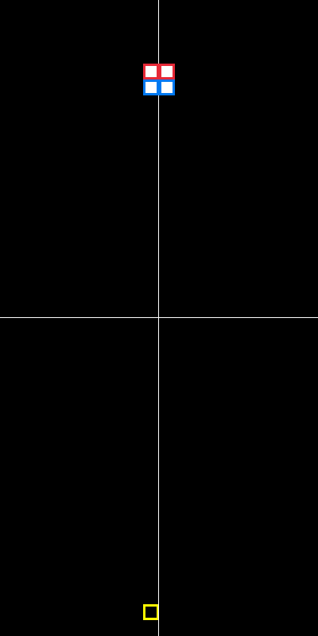
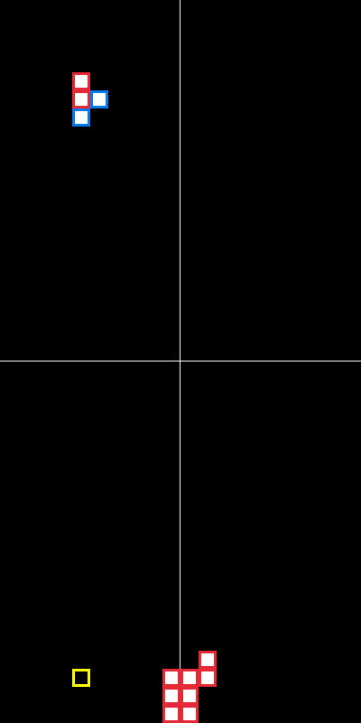
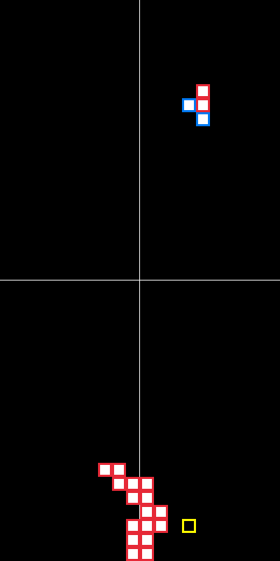

# Zizris

A small Tetris clone written in [Zig](https://ziglang.org/), rendered with [raylib](https://www.raylib.com/) via [raylib-zig](https://github.com/raylib-zig/raylib-zig).

> **This project exists purely for fun and for learning Zig.**.

## Why this exists

I wanted a project small enough to finish, interactive enough to be fun, and meaty enough to touch the parts of Zig that are hard to learn from reading docs alone:

- `@Vector` for 2D positions and grid math
- `comptime`-friendly struct and enum definitions
- the build system (`build.zig`, `build.zig.zon`, dependencies from git)
- immediate mode rendering approch

It is deliberately **not** a polished game. There is no scoring, no levels, no sound, no saved state, and the visuals are three rectangles and a yellow ghost outline. The goal is the journey.

## Build and run

```sh
zig build          # build the executable
zig build run      # build and launch the game
```

There is also a small helper script, `wzig`, for incremental development with hot reload:

```sh
nu wzig            # requires Nushell
```

The debug build draws extra helpers on screen (the lowest-block markers and a crosshair), so use `zig build` (Debug) if you want to see them.

## Controls

| Key                     | Action               |
| ----------------------- | -------------------- |
| `←` / `→`               | Move left / right    |
| `↓`                     | Hard drop            |
| `Space`                 | Rotate               |
| `Ctrl + W` / `Ctrl + C` | Quit                 |

Closing the window also quits.

# show




